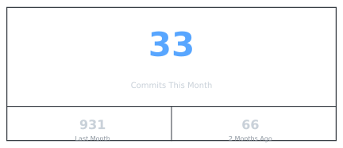
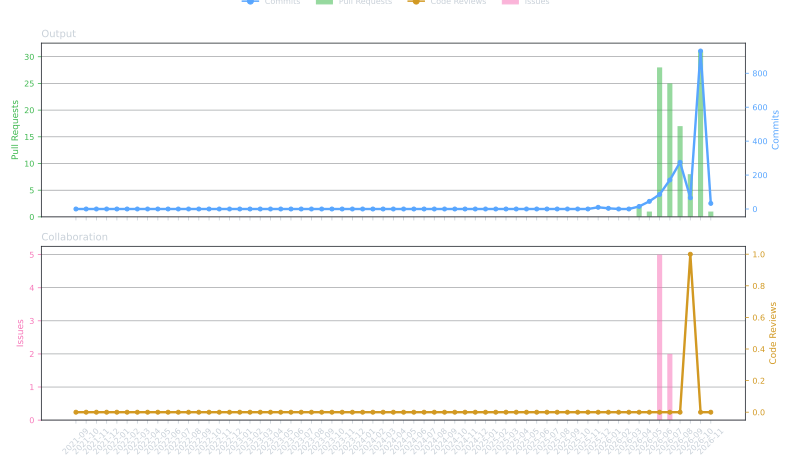
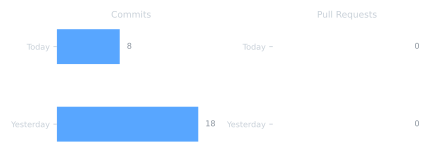

<h1 align="center">Amaresh Hebbar</h1>
 

  <b>Founding AI Engineer @ <a href="https://www.linkedin.com/company/impossible-ai/">Impossible AI</a> · Applied AI Engineer @ <a href="https://anacodicai.org/get-started">AnacodicAI Labs</a></b> 
    <b>AI Agents · Model Testing · Model Training · Search Models · Medical AI</b> 
  I build AI systems, train AI models, check that they actually work, and put them into real products.

  
  
  
  
  
  
  
  
  

### About
 
I build AI systems that do real work: teams of AI agents, tools that run AI models, tools that check what changed inside a model, AI that runs on your phone, and models trained for one specific job. I take them all the way from idea to a working product.
 
* **Founding AI Engineer at [Impossible AI](https://www.linkedin.com/company/impossible-ai/).** Building the AI that runs directly on the phone for an [AI fitness app](https://humanovaminds.com/impossible-ai), and only uses the cloud when it has to. 80% of sessions run fully offline, with answers starting in about 45ms.
* **Applied AI Engineer at [AnacodicAI Labs](https://anacodicai.org/get-started)** (a nonprofit started at Boston University). Volunteering on ClinicalSearch, a team of AI agents that helps plastic surgeons find and check medical research.
* **Open source author.** Published **[Modeldiffr](https://pypi.org/project/modeldiffr/)** on PyPI. It shows exactly what changed when someone trains, shrinks, merges or edits an AI model, and whether the change is real or just random noise. Also published **[TrueNorth](https://pypi.org/project/truenorth-framework/)** (build AI chat from a simple config file, 1,258 tests, works with 8 AI providers, about 90% cheaper), **[BitNarrow](https://pypi.org/project/bitnarrow/)** (stops small models refusing safe requests, no training needed), and **[GitGrounded](https://pypi.org/project/gitgrounded/)** (catches AI mistakes before users see them).
* **Fixed a bug in Unsloth.** Fixed a crash that stopped Unsloth training from starting on Transformers 5.5 and newer ([PR #897](https://github.com/unslothai/unsloth-zoo/pull/897)).
* **Trained 16 medical AI models.** Published a **[set of 16 medical models](https://huggingface.co/collections/AmareshHebbar/medical-ai-fine-tuned-model-suite)** (Qwen2.5), each trained for one job: medical codes, billing codes, clinical terms, reading clinical notes, Indian health scheme packages, and Hindi medical help. Every model uses the same 4 step training recipe on real medical data, and the [training data is public too](https://huggingface.co/collections/AmareshHebbar/axismapper-medical-ai-suite).
* **Made small models faster and smarter.** **[ShortThink](https://github.com/amareshhebbar/ShortThink)** thinks out loud 42% less and answers 1.8x faster. **[ToolSure](https://github.com/amareshhebbar/ToolSure)** uses tools correctly 94.2% of the time (up from 81.2%). **[Stretch32K](https://github.com/amareshhebbar/Stretch32K)** reads 8x more text at once, trained on a single GPU.
* **Mentored 10 engineering interns** across frontend, backend and mobile, while shipping two AI products at the same time.
* **Hackathons.** SANS FIND EVIL! (AI for hacked computer investigations) · Google Cloud Rapid Agent (GitLab Partner) · INDIA RUNS (Redrob AI × Hack2Skill, Data & AI) · BITSoM Vertex Builders Pitch Fest (Top 150 of 2,300, Software Automation AI Track).
* **I prove my results.** Public benchmarks (100% correct findings on SANS forensics tasks), public training data, model comparisons with real statistics, and [every training run tracked online](https://wandb.ai/amareshhebbar-/axiomapper).
* Based in Bengaluru, India · **Open to remote AI engineering roles** (IST, happy to overlap with US and EU hours).

### Experience
 
| Role | Organisation | What I do |
|------|--------------|-----------|
| **Founding AI Engineer** Mar 2025 to Present | [Impossible AI](https://www.linkedin.com/company/impossible-ai/) · [Website](https://humanovaminds.com/impossible-ai) Bengaluru, India (Remote) | I build the AI that runs directly on the phone in the Impossible AI fitness app, and falls back to the cloud only when needed. 80% of sessions run fully offline, with answers starting in about 45ms. I also built the system that sends each question to the right one of 16 specially trained models, run the Supabase backend with zero errors at peak traffic, and mentor 10 engineering interns |
| **Applied AI Engineer (Research & Development)** Aug 2026 to Present | [AnacodicAI Labs](https://anacodicai.org/get-started) (nonprofit started at Boston University) · [GitHub](https://github.com/anacodicAI-labs) · [Agentic Cookbook](https://github.com/anacodicAI-labs/anacodic-agentic-cookbook) Volunteer, working with project lead [Rashan Kaur](https://www.linkedin.com/in/rashan-kaur/) | ClinicalSearch helps plastic surgeons find and check medical research. 4 AI agents work together: one searches, one fact checks, one writes the answer, and one grades it. It searches over 2.5 million medical paper summaries. I made it run fully on a local computer with Ollama, which made answers 38% faster. I also added a review step that finds 22% more of the right papers, and built tests that compare answer quality across AI providers |
 
Featured on LinkedIn: [view post](https://lnkd.in/p/dp_jS7S2)
 

### Tech Stack

  
  
  
  

  
  
  
  
  
  
  

  
  
  
  
  
  
  
  

  
  
  
  
  
  
  

  
  
  
  
  

  
  
  
  
  
  
  
  
  

  
  
  
  
  

### Featured Projects

| Project | What it does | Stack | Highlights |
|---------|-------------|-------|-----------|
| **[Modeldiffr](https://github.com/amareshhebbar/modeldiffr)** [PyPI](https://pypi.org/project/modeldiffr/) | Shows exactly what changed when someone fine tunes, shrinks, merges or edits an AI model. One command runs the old and new model side by side and tells you what got better, what got worse, by how much, and whether the change is real or just random noise | Python · PyTorch · Transformers | Main project · every change comes with a confidence range · word by word comparison of how the two models answer · can block a release in CI if a model got worse · works with [BitNarrow](https://github.com/amareshhebbar/bitnarrow) |
| **[BitNarrow](https://github.com/amareshhebbar/bitnarrow)** [PyPI](https://pypi.org/project/bitnarrow/) · [Weights](https://huggingface.co/collections/AmareshHebbar/abliteration-weights) | Stops small compressed AI models from refusing safe requests, without any retraining. It finds the part of the model that causes the refusal and removes it directly from the weights | Python · PyTorch · bitsandbytes · Unsloth | Works on 4 bit models · edits every main layer of the model · ships as a small 386MB patch you can swap in · 0% refusals while keeping 100% of the model's reasoning · [ready to use weights](https://huggingface.co/collections/AmareshHebbar/abliteration-weights) |
| **[TrueNorth](https://github.com/amareshhebbar/TrueNorth)** [PyPI](https://pypi.org/project/truenorth-framework/) | Lets developers build AI chat features by describing what they want in a simple YAML file. It handles the whole conversation for you, step by step, from the first message to the final answer | Python · TS · Go · RN | 1,258 tests · 4 SDKs on PyPI and NPM · blocks 94% of made up answers · works with 8 AI providers · cuts AI costs by about 90% |
| **[GitGrounded](https://github.com/amareshhebbar/gitgrounded)** [PyPI](https://pypi.org/project/gitgrounded/) | Catches problems before your users see them when you change a prompt or swap an AI model. It writes tests for the change, compares the old and new answers, and gives a clear PASS, WARN or FAIL | Python · Claude · Groq · Ollama · Streamlit | Works on code changes or a live API · keeps a history of every version · posts results on your pull request automatically · 22 tests in CI · Top 150 of 2,300 at BITSoM Vertex Builders Pitch Fest |
| **[RunGated](https://github.com/amareshhebbar/RunGated)** | A security guard that sits between an AI agent and the outside world. Every request the agent makes is checked against its rules, then allowed, cleaned of private data, paused for review, blocked, or locked down | Go · Cedar · MCP · OpenAI | 5 possible decisions for every request · rules written in Cedar · checks every tool the agent tries to use · training a model to spot attacks next · Apache 2.0 |
| **[RootCast](https://github.com/amareshhebbar/RootCast)** *(in progress, with a teammate)* | A flight recorder for AI agents. It records every decision the agent makes, finds the exact step where things went wrong, and replays the run with one fix to prove the fix works | Python · TypeScript · Tracing | I build the AI and the root cause logic · points to the first wrong step, not just the final error · proves every fix by replaying it |
| **[FaultLine](https://github.com/amareshhebbar/FaultLine)** *(in progress, with a teammate)* | Breaks an online shop backend on purpose, then checks whether an AI can correctly explain what broke and why | Go · Python · Kubernetes · Grafana | I build the part that causes the failures · every failure is logged with the true cause · measures how often the AI gets the cause right · MIT |
| **[Medical AI Suite](https://huggingface.co/collections/AmareshHebbar/medical-ai-fine-tuned-model-suite)** [Datasets](https://huggingface.co/collections/AmareshHebbar/axismapper-medical-ai-suite) | 16 small AI models, each trained for one medical job such as medical coding, billing, or reading clinical notes | QLoRA · DoRA · ORPO · Unsloth · HF | 13 models and 16 training datasets published · made up words in under 1% of output · correct output format over 99% of the time · [try the demo](https://huggingface.co/spaces/AmareshHebbar/icd10-coder-demo) · Apache 2.0 |
| **[LogPoseSIFT](https://github.com/amareshhebbar/logposesift)** [Devpost](https://devpost.com/software/logpose-sift-autonomous-dfir) | An AI investigator for hacked computers. It runs over 200 standard forensics tools on its own and reports what the attacker did | Go · Claude · Gemini · MCP · Volatility 3 | 100% of its findings were correct · found 92.8% of all real evidence · never made anything up · SANS FIND EVIL! Hackathon · grew into [AllBlue](https://devpost.com/software/allblue) for Splunk |
| **[ShiftLeft](https://github.com/amareshhebbar/ShiftLeft)** [Devpost](https://devpost.com/software/shiftleft) | Fixes bugs on its own. A team of 5 AI agents reads the code, figures out the bug, writes the fix, and opens a merge request | Python · LangGraph · Gemini · GitLab MCP | About 60 seconds from bug to fix · no human needed · Google Cloud Rapid Agent Hackathon |
| **layerFourth** *(private repo)* | An AI that browses the web on your own computer, moving the mouse and typing like a person. If it cannot read a page one way, it tries 3 more ways, ending with reading the screen like an image | Python · CDP · Vector DB | Controls Chrome directly, no Playwright or Selenium · all 134 tests passing · remembers things short term and long term |
| **[Plyscope](https://github.com/amareshhebbar/Plyscope)** | Shows the hidden layers inside CAD drawings saved as PDF. You can see what each layer draws on every page, and turn layers on or off to compare them | Python · FastAPI · PyMuPDF · NumPy | Measures exactly what each layer adds to each page · spots empty layers and title blocks · same file always gives the same result · export as table, JSON or CSV · runs fully on your computer, nothing sent online |

  

<b>More projects</b>

 

| Project | What it does | Stack | Highlights |
|---------|-------------|-------|-----------|
| **[HireSignal](https://github.com/amareshhebbar/hiresignal)** [Live sandbox](https://huggingface.co/spaces/AmareshHebbar/hiresignal) | Ranks 100,000 job candidates against a job description in about 35 seconds on a normal computer, and spots fake profiles | Python · sentence transformers · NumPy | No GPU, no paid API, no internet needed · caught 85 fake profiles · 10 tests · INDIA RUNS Hackathon |
| **[PocketLLM](https://github.com/amareshhebbar/PocketLLM)** | An Android chat app that runs AI models fully on your phone, with no internet | React Native · Expo · MediaPipe C++ · AWS S3 | 9 models to choose from (0.4 to 5.2 GB) · your messages never leave the phone |
| **[raiseTicket / IssueLoop](https://github.com/amareshhebbar/raiseTicket)** | Turns failing tests in open source projects into tickets, suggests fixes, tests them again, and escalates what it cannot fix | Python · Supabase · Ollama | Runs on your own computer first · works with any AI provider you choose |
| **[OceanAI Website](https://github.com/amareshhebbar/oceanai_website)** | A 3D product website built to show investors the OceanAI health platform | Next.js · TypeScript | 65 files, 28 pages · live AI demos built into the site |
| **[HatPet](https://github.com/amareshhebbar/hatpet)** | A small pet that lives on your Linux desktop. It walks around the screen, rests, and can be picked up and dragged with the mouse | Godot 4 · GDScript | Works around Wayland limits that block moving windows · built from scratch |

Fine tuned models live on **[Hugging Face](https://huggingface.co/AmareshHebbar)** · Packages on **PyPI** ([modeldiffr](https://pypi.org/project/modeldiffr/) · [truenorth-framework](https://pypi.org/project/truenorth-framework/) · [bitnarrow](https://pypi.org/project/bitnarrow/) · [gitgrounded](https://pypi.org/project/gitgrounded/)) · Training runs tracked on **[Weights & Biases](https://wandb.ai/amareshhebbar-/axiomapper)**

### Model Training: Fine Tuning, Embeddings, Vision and Model Surgery

Every project here takes an existing open AI model and makes it better at something specific. Each one comes with the trained model or the full code to rebuild it, and is measured against the original model.

<b>33 models · 29 datasets · 3 live Spaces on <a href="https://huggingface.co/AmareshHebbar">Hugging Face</a></b>

| Project | Type | Base models | Method | Released | Headline |
|---------|------|-------------|--------|----------|----------|
| **[ShortThink](https://github.com/amareshhebbar/ShortThink)** | Faster reasoning | Qwen2.5 3B Instruct | Trained on pairs of answers so the model learns to prefer short, correct reasoning over long rambling | Code on GitHub · model on [Hugging Face](https://huggingface.co/AmareshHebbar) | Thinks out loud 42% less · answers 1.8x faster · more accurate on GSM8K math than the original |
| **[ToolSure](https://github.com/amareshhebbar/ToolSure)** | Correct tool use | Small instruct models | Trained with strict rules on what a tool call must look like, and penalised for making up tools or calling tools it does not need | Code on GitHub · model on [Hugging Face](https://huggingface.co/AmareshHebbar) | Correct tool calls up from 81.2% to 94.2% · 65% fewer made up or unneeded tool calls |
| **[Stretch32K](https://github.com/amareshhebbar/Stretch32K)** | Longer memory | 7B model (reads 4K tokens by default) | Stretched how far the model can read, then trained it on one GPU to stay accurate | Code on GitHub · model on [Hugging Face](https://huggingface.co/AmareshHebbar) | Reads 8x more text at once (4K to 32K tokens, about 4 pages to 60) · finds a hidden fact in long text 98.5% of the time |
| **[Vec16](https://github.com/amareshhebbar/Vec16)** | Tiny search embeddings | SmolLM2 135M and 360M · Gemma 3 270M · Qwen2.5 0.5B · Qwen3 0.6B and 1.7B | Turns small chat models into search models by teaching them from much bigger search models | Code on GitHub · runs on Colab, RunPod, ONNX, vLLM and in the browser | Stores each document in just 16 bytes, 256x smaller than usual · quality check must pass before any release |
| **[FlipAware](https://github.com/amareshhebbar/FlipAware)** | Smarter search embeddings | MiniLM · BGE · E5 · ModernBERT · EmbeddingGemma · Qwen3 Embedding | Trained on sentence pairs that look almost the same but mean different things | Code on GitHub · drop in upgrades for 6 popular search models | Tells apart 8 kinds of look alike sentences (not vs is, different numbers, who did what, before vs after, and more) while keeping normal search quality |
| **[BitNarrow Abliteration Weights](https://huggingface.co/collections/AmareshHebbar/abliteration-weights)** | Fewer refusals, no training | [Qwen2.5 1.5B](https://huggingface.co/AmareshHebbar/Qwen2.5-1.5B-Abliterated) · [Qwen2.5 1.5B Instruct](https://huggingface.co/AmareshHebbar/Qwen2.5-1.5B-Instruct-Abliterated) · [Qwen2.5 7B Instruct](https://huggingface.co/AmareshHebbar/Qwen2.5-7B-Instruct-Abliterated) · [Llama 3.2 3B Instruct](https://huggingface.co/AmareshHebbar/Llama-3.2-3B-Instruct-Abliterated) · [Llama 3.1 8B Instruct](https://huggingface.co/AmareshHebbar/Llama-3.1-8B-Instruct-Abliterated) · [Gemma 2 2B IT](https://huggingface.co/AmareshHebbar/gemma-2-2b-it-Abliterated) · [Phi 3.5 mini Instruct](https://huggingface.co/AmareshHebbar/Phi-3.5-mini-instruct-Abliterated) | Finds the part of the model that causes refusals and removes it from the weights, made with [BitNarrow](https://github.com/amareshhebbar/bitnarrow) | 7 models from 4 families | 0% refusals while keeping 100% of the reasoning · small 386MB patch · checked with [Modeldiffr](https://huggingface.co/AmareshHebbar/modeldiffr_audits) |
| **[AtomicRAG](https://github.com/amareshhebbar/AtomicRAG)** | Breaking down hard questions | Qwen2.5 1.5B | Trained in 3 stages to split a hard question into small simple ones, using 42K examples and 71K good vs bad answer pairs | Code and benchmarks on GitHub | Gets the number of steps right 84% of the time (was 43%) · finds the right document 67% of the time (was 31%) · about 50ms vs 1800ms for GPT 4o |
| **[LeetCode Coder Suite](https://huggingface.co/collections/AmareshHebbar/leetcode-multi-language-coder-suite)** | Coding problems | Qwen2.5 Coder 7B | One model trained per language: [Python](https://huggingface.co/AmareshHebbar/leetcode-python-qwen25-coder-7b) · [Java](https://huggingface.co/AmareshHebbar/leetcode-java-qwen25-coder-7b) · [C++](https://huggingface.co/AmareshHebbar/leetcode-cpp-qwen25-coder-7b) · [JavaScript](https://huggingface.co/AmareshHebbar/leetcode-javascript-qwen25-coder-7b) | 4 models + 4 versions that run on a laptop + [try the demo](https://huggingface.co/spaces/AmareshHebbar/leetcode-coder-demo) | Give it a problem and a hint, it writes the solution · trained only on solutions that actually ran and passed |
| **[Medical AI Suite](https://huggingface.co/collections/AmareshHebbar/medical-ai-fine-tuned-model-suite)** | Medical jobs | Qwen2.5 Instruct 1.5B, 3B, 7B | Same 4 step training recipe for every model, run on one A40 GPU | 13 models + one combined 8B model + [try the demo](https://huggingface.co/spaces/AmareshHebbar/icd10-coder-demo) | Medical codes, billing, clinical terms, Indian health scheme packages, Hindi medical help · full list [below](#hugging-face-medical-ai-fine-tuned-model-suite) |

#### Open Training Datasets

| Collection | Datasets | Rows | What it is |
|-----------|:--------:|------|------------|
| **[AxisMapper Medical AI Suite](https://huggingface.co/collections/AmareshHebbar/axismapper-medical-ai-suite)** | 16 | about 470K | Medical training data built from official sources like the CMS FY2026 ICD 10 code list, including a [symptom diagnoser](https://huggingface.co/datasets/AmareshHebbar/symptom-diagnoser-sft) set (119K rows) and a [LOINC lab test coder](https://huggingface.co/datasets/AmareshHebbar/loinc-coder-sft) set |
| **[LeetCode Code Gen Datasets](https://huggingface.co/collections/AmareshHebbar/leetcode-code-gen-datasets)** | 4 | about 11.2K | Coding problems with working solutions in Python, Java, C++ and JavaScript, every solution tested by actually running it |
| **[Astrology and Divination SFT](https://huggingface.co/collections/AmareshHebbar/astrology-and-divination-sft-datasets)** | 9 | about 1.8M | Rule based astrology training data with sources for every answer, covering Vedic ([1M rows](https://huggingface.co/datasets/AmareshHebbar/jyotish-llm-sft)), Western, KP, Prashna, BaZi, Chinese Zodiac, Nine Star Ki and two numerology systems |

### Open Source Contributions

| Repository | Contribution | Impact |
|-----------|--------------|--------|
| **[unslothai/unsloth zoo](https://github.com/unslothai/unsloth-zoo)** | [PR #897](https://github.com/unslothai/unsloth-zoo/pull/897): resolved a critical `ModuleNotFoundError` import crash | Restored runtime stability for LLM training workflows on Transformers 5.5+ |
| **[anacodicAI labs](https://github.com/anacodicAI-labs)** | ClinicalSearch multi agent retrieval, local Ollama inference stack, and the [Agentic Cookbook](https://github.com/anacodicAI-labs/anacodic-agentic-cookbook) | Nonprofit clinical AI research founded at Boston University |

### Hugging Face: Medical AI Fine Tuned Model Suite

A suite of **Qwen2.5 specialist models**, one per clinical task. Each model is trained through a consistent **QLoRA → DoRA → ORPO → merge** pipeline (via [Unsloth](https://github.com/unslothai/unsloth) + TRL) on a **dedicated, published SFT dataset**, with no synthetic training data. Released under **Apache 2.0**; training tracked on [W&B](https://wandb.ai/amareshhebbar-/axiomapper).

> Collection: **[Medical AI Fine Tuned Model Suite](https://huggingface.co/collections/AmareshHebbar/medical-ai-fine-tuned-model-suite)** · Datasets: **[AxisMapper Medical AI Suite](https://huggingface.co/collections/AmareshHebbar/axismapper-medical-ai-suite)** · Code: **[AxisMapper](https://github.com/amareshhebbar/AxisMapper)**

| Model | Size | Task | Dataset (rows) | Method | GPU |
|-------|:----:|------|----------------|--------|-----|
| [icd10-coder-qwen25-7b](https://huggingface.co/AmareshHebbar/icd10-coder-qwen25-7b) | 7B | Clinical text → ICD 10 CM code + justification | [icd10-coder-sft](https://huggingface.co/datasets/AmareshHebbar/icd10-coder-sft) (74.7k) | QLoRA → DoRA → ORPO → merge | A40 48GB |
| [icd10-coder-qwen25-7b-merged](https://huggingface.co/AmareshHebbar/icd10-coder-qwen25-7b-merged) | 8B | Merged full weights build of the ICD 10 coder (no adapter load) | [icd10-coder-sft](https://huggingface.co/datasets/AmareshHebbar/icd10-coder-sft) (74.7k) | QLoRA → DoRA → ORPO → merge | A40 48GB |
| [snomed-mapper-qwen25-7b](https://huggingface.co/AmareshHebbar/snomed-mapper-qwen25-7b) | 7B | Clinical concept → SNOMED CT mapping | [snomed-mapper-sft](https://huggingface.co/datasets/AmareshHebbar/snomed-mapper-sft) (74.7k) | QLoRA → DoRA → ORPO → merge | A40 48GB |
| [clinical-summarizer-qwen25-7b](https://huggingface.co/AmareshHebbar/clinical-summarizer-qwen25-7b) | 7B | Clinical note summarization | [clinical-summarizer-sft](https://huggingface.co/datasets/AmareshHebbar/clinical-summarizer-sft) (30k) | QLoRA → DoRA → ORPO → merge | A40 48GB |
| [medical-billing-qwen25-3b](https://huggingface.co/AmareshHebbar/medical-billing-qwen25-3b) | 3B | Medical billing code generation | [medical-billing-sft](https://huggingface.co/datasets/AmareshHebbar/medical-billing-sft) (17k) | QLoRA → DoRA → ORPO → merge | A40 48GB |
| [cpt-coder-qwen25-3b](https://huggingface.co/AmareshHebbar/cpt-coder-qwen25-3b) | 3B | Procedure text → CPT code | [cpt-coder-sft](https://huggingface.co/datasets/AmareshHebbar/cpt-coder-sft) (17k) | QLoRA → DoRA → ORPO → merge | A40 48GB |
| [radiology-coder-qwen25-3b](https://huggingface.co/AmareshHebbar/radiology-coder-qwen25-3b) | 3B | Radiology report → diagnostic code | [radiology-coder-sft](https://huggingface.co/datasets/AmareshHebbar/radiology-coder-sft) (25.1k) | QLoRA → DoRA → ORPO → merge | A40 48GB |
| [pmjay-classifier-qwen25-3b](https://huggingface.co/AmareshHebbar/pmjay-classifier-qwen25-3b) | 3B | India PM JAY scheme package classification | [pmjay-classifier-sft](https://huggingface.co/datasets/AmareshHebbar/pmjay-classifier-sft) (11.1k) | QLoRA → DoRA → ORPO → merge | A40 48GB |
| [discharge-qa-qwen25-3b](https://huggingface.co/AmareshHebbar/discharge-qa-qwen25-3b) | 3B | QA over discharge summaries | [discharge-qa-sft](https://huggingface.co/datasets/AmareshHebbar/discharge-qa-sft) (30k) | QLoRA → DoRA → ORPO → merge | A40 48GB |
| [medical-ner-qwen25-3b](https://huggingface.co/AmareshHebbar/medical-ner-qwen25-3b) | 3B | Clinical named entity recognition | [medical-ner-sft](https://huggingface.co/datasets/AmareshHebbar/medical-ner-sft) (16.7k) | QLoRA → DoRA → ORPO → merge | A40 48GB |
| [hindi-medical-qwen25-3b](https://huggingface.co/AmareshHebbar/hindi-medical-qwen25-3b) | 3B | Hindi language medical assistant | [hindi-medical-sft](https://huggingface.co/datasets/AmareshHebbar/hindi-medical-sft) (19.7k) | QLoRA → DoRA → ORPO → merge | A40 48GB |
| [icd10-to-drg-qwen25-1b](https://huggingface.co/AmareshHebbar/icd10-to-drg-qwen25-1b) | 1.5B | ICD 10 → DRG for reimbursement grouping | [icd10-to-drg-sft](https://huggingface.co/datasets/AmareshHebbar/icd10-to-drg-sft) (5.39k) | QLoRA → DoRA → ORPO → merge | A40 48GB |
| [insurance-classifier-qwen25-1b](https://huggingface.co/AmareshHebbar/insurance-classifier-qwen25-1b) | 1.5B | CPT/HCPCS → Stark Law DHS classification | [insurance-classifier-sft](https://huggingface.co/datasets/AmareshHebbar/insurance-classifier-sft) (1.6k) | QLoRA → DoRA → ORPO → merge | A40 48GB |
| [ayurveda-icd-qwen25-1b](https://huggingface.co/AmareshHebbar/ayurveda-icd-qwen25-1b) | 1.5B | Ayurveda term → ICD mapping | [ayurveda-icd-sft](https://huggingface.co/datasets/AmareshHebbar/ayurveda-icd-sft) (3k) | QLoRA → DoRA → ORPO → merge | A40 48GB |
| [pharmacy-ner-qwen25-1b](https://huggingface.co/AmareshHebbar/pharmacy-ner-qwen25-1b) | 1.5B | Pharmacy and drug entity recognition | [pharmacy-ner-sft](https://huggingface.co/datasets/AmareshHebbar/pharmacy-ner-sft) (3.5k) | QLoRA → DoRA → ORPO → merge | A40 48GB |

Pipeline (all models): Qwen2.5 Instruct base → <b>QLoRA</b> SFT (4 bit NF4, rank 16, α 32) → <b>DoRA</b> → <b>ORPO</b> preference alignment → adapter <b>merge</b>. Optimizer paged_adamw_8bit · cosine schedule, LR 0.0002 · trained on RunPod (NVIDIA A40 48GB) via Unsloth + TRL. Per model wall time ranges from about 0.4 h (1.5B configs) to about 1.9 h (7B configs). Training tracked at <a href="https://wandb.ai/amareshhebbar-/axiomapper">wandb.ai/amareshhebbar</a>. Datasets built from authoritative real world sources (for example CMS FY2026 ICD 10 CM and the HCPCS Stark Law DHS list), not LLM generated.

**Live demos (Spaces):** [icd10 coder demo](https://huggingface.co/spaces/AmareshHebbar/icd10-coder-demo) · [hiresignal](https://huggingface.co/spaces/AmareshHebbar/hiresignal)

### Hackathons

| Submission | Hackathon | Track | What it does |
|-----------|-----------|-------|--------------|
| **[GitGrounded](https://github.com/amareshhebbar/gitgrounded)** · [PyPI](https://pypi.org/project/gitgrounded/) | BITSoM Vertex × H2S Builders Pitch Fest 2026 (Top 150 of 2,300) | Software Automation AI | Tests an AI app before and after a prompt or model change, AI written targeted tests, AI judge, PASS, WARN, or FAIL verdict |
| **[ShiftLeft](https://devpost.com/software/shiftleft)** · [Repo](https://github.com/amareshhebbar/ShiftLeft) | Google Cloud Rapid Agent | GitLab Partner | Label a GitLab issue → autonomous 5 agent pipeline reads the repo, triages the bug, writes the fix, and opens an MR in under 60 seconds |
| **[Poneglyphs: ShiftLeft](https://devpost.com/software/shiftleft-ml5aep)** | Google Cloud Rapid Agent | GitLab Partner | Label a GitLab issue `shiftleft` → 5 agent pipeline reads GitLab Orbit, triages, writes fix, opens MR |
| **[LogPoseSIFT](https://devpost.com/software/logpose-sift-autonomous-dfir)** · [Repo](https://github.com/amareshhebbar/logposesift) | SANS FIND EVIL! | DFIR Automation | Autonomous DFIR orchestrator: deploys an AI crew via strict MCP endpoints, runs SIFT diagnostics, triages and self corrects in seconds |
| **[AllBlue](https://devpost.com/software/allblue)** | SANS FIND EVIL! | DFIR Automation | Splunk alerts trigger autonomous AI forensic triage, with IOC findings pushed back as structured events. 100% precision, 0 hallucinations |
| **[HireSignal](https://github.com/amareshhebbar/hiresignal)** · [Live sandbox](https://huggingface.co/spaces/AmareshHebbar/hiresignal) | INDIA RUNS · Redrob AI × Hack2Skill | Data & AI Challenge | Ranks 100K candidates against a Senior AI Engineer JD in about 35s on CPU: multi signal scoring, 85 honeypots detected, per candidate reasoning |

### GitHub Stats

  <table>
    <tr>
      <td>

      </td>
      <td>

      </td>
    </tr>
  </table>

  

### Activity

  

  

  

Auto generated from live account data, refreshed every 6 hours · Last updated: <!--STATS-TIME-->2026-11-14 12:40 UTC<!--END-->

### Highlights

* Founding AI Engineer at **[Impossible AI](https://www.linkedin.com/company/impossible-ai/)** (Mar 2025 to Present)
* Applied AI Engineer on **ClinicalSearch** at **[AnacodicAI Labs](https://anacodicai.org/get-started)** (Aug 2026 to Present)
* Published **[Modeldiffr](https://pypi.org/project/modeldiffr/)**, **[TrueNorth](https://pypi.org/project/truenorth-framework/)**, **[BitNarrow](https://pypi.org/project/bitnarrow/)**, and **[GitGrounded](https://pypi.org/project/gitgrounded/)** to PyPI
* Upstream contribution to **[unslothai/unsloth zoo PR #897](https://github.com/unslothai/unsloth-zoo/pull/897)**
* Released a **[16 model medical AI suite](https://huggingface.co/collections/AmareshHebbar/medical-ai-fine-tuned-model-suite) + [16 open SFT datasets](https://huggingface.co/collections/AmareshHebbar/axismapper-medical-ai-suite)** on Hugging Face
* Released **[Abliteration Weights](https://huggingface.co/collections/AmareshHebbar/abliteration-weights)** produced by BitNarrow
* **1000+ problems solved** on [LeetCode](https://leetcode.com/u/GVAmaresh/)
* B.E. Computer Science & Engineering, Dayananda Sagar College of Engineering (2021 to 2025)

  <i>Open to remote first AI engineering roles: LLM infrastructure, agentic systems, model evaluation, fine tuning, or AI product engineering.</i> 
  <a href="mailto:hebbar.gvamaresh@gmail.com">hebbar.gvamaresh@gmail.com</a> · <a href="https://www.linkedin.com/in/gvamaresh/">LinkedIn</a> 
  <b>Let's build something intelligent.</b>

  

